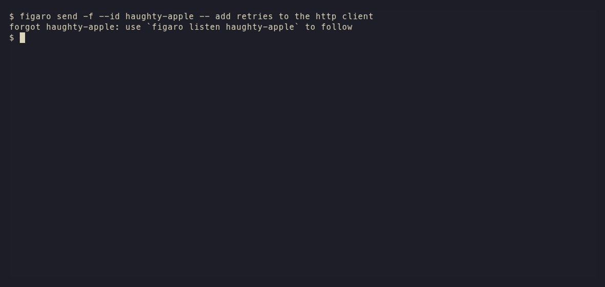

<p align="center">
  <a href="https://figar.org"></a>
</p>

<p align="center">
  <a href="https://github.com/jack-work/figaro/releases/latest"></a>
  <a href="./LICENSE"></a>
  
  
</p>

*Largo al factotum della calcolatore.*

figaro is a programmer's harness. Its agents, figaros, are durable: each one is a log on disk, served by a daemon called the angelus (for you catholics out there) that keeps well over a thousand of them in under 500 MB of memory and runs fast on a laptop from 2004. Works with Claude, GitHub Copilot, OpenRouter, Azure, and any provider that speaks Anthropic Messages, OpenAI Chat Completions or the Responses API.

<p align="center"></p>

> [!NOTE]
> figaro is under heavy development and released several times a day, mostly by figaros themselves. Pin a version if you need it to sit still ([Releases](#releases)).

## Agents you can see and steer

- Jump between figaros fast and attend any subagent: `figaro attend <id>`, `figaro listen <id>`, `figaro show <id>` with every tool call it made.
- `figaro fork <id>:12 -- <p>` branches at any turn, and `figaro promote <id>` raises a fork in the tree at once.
- Compaction is forking: `figaro succeed @role -- <handoff>` forks, hands off and recasts the role, so you can read exactly what was carried over.
- The angelus works like a tmux server. Drop the SSH connection and the turn keeps running, so a whole workflow built on figaro still works over SSH.

## The prompt cache stays warm

Providers keep a KV cache: the attention keys and values for a prompt prefix they have already processed, reused by any request that starts with the same bytes. Cache reads cost a fraction of fresh input ([Anthropic](https://docs.anthropic.com/en/docs/build-with-claude/prompt-caching): 0.1x, or 0.05x on Opus 5.5 and Sonnet 5.5; [OpenAI](https://platform.openai.com/docs/guides/prompt-caching): up to 95% off) and reach the first token sooner. figaro keeps each agent's prefix byte-stable: a message is translated once and resent byte for byte, state arrives as reminders on the newest message, and forks start from their parent's bytes. Across 1,646 figaros on my machine since July, 93% of input tokens were cache reads. Switching models costs one cold turn, since a model can't read another's cache; changing the credo rebuilds it.

## Forms

A form is a durable object: key/value state with an append-only patch log, fsync'd before anyone can read it, and an immutable AVL tree in memory that readers never lock. A figaro that studies a form (`figaro study <id> @form`) gets each change as a delta on its next message, without starting a turn or rewriting what came before. Put web data in a form, add a heartbeat (we use figla) or a `figaro send`, and your agents react to your data as it changes:

```bash
figaro form new -S name=repo
figaro set --id @repo stats "$(curl -s https://api.github.com/repos/jack-work/figaro | jq -c '{stars: .stargazers_count}')"
```

[Methods](skills/figaro/reference/methods.md) are small, fast models that write form data on hooks; the first one picks the reasoning effort for each message. The Go SDK (`sdk/`) reads, patches and follows forms from your own code.

## Scale and durability

- About 1,700 figaros on my machine, and the angelus sits around 320 MB under a 512 MB soft limit (`[memory] soft_limit_mb`).
- Crash-safe: every log is append-only and synced before it's visible, and a prompt sent during a restart is spooled and delivered after.
- `/` in `:ls` fuzzy-finds a figaro by handle or mantra, `:comment` pins a note to a passage, and `M-Enter` opens `file:line` in your editor.
- I daily-drive it at my big tech employer: hundreds of hours of heavy use, and it cooks.

## Federation and deployment

- Listen to a figaro on any server with `FIGARO_TROUPE=<name> figaro listen <id>`. Machines federate as troupes, still in development.
- Your identity system plugs in: OIDC issuers, your reverse proxy's user headers, or api keys, with grants and troupe policy for each principal.
- A Nix flake with NixOS, home-manager and container modules. Sandboxing (`figaro box`) is coming in gradually.

## The shell or the pager

Drive figaros from the shell (`figaro -- <prompt>`, `figaro send -f`) or from the pager (bare `figaro`). Neither is required; the shell is the quick one.

<p align="center"></p>

## Security, plainly

figaro isn't secure out of the box: it runs with your user's permissions, and any figaro can message any other on its node. Bring your own sandbox for now; secure defaults are coming. No MCP, by design: figaro is CLI-first, so wrap an MCP server in a CLI and sandbox it.

## Install

```bash
curl -fsSL https://figar.org/install.sh | sh
irm https://figar.org/install.ps1 | iex          # Windows
nix profile install github:jack-work/figaro
go install github.com/jack-work/figaro/cmd/figaro@latest
```

## First run

```bash
figaro provider login anthropic   # or copilot, openrouter, azure
figaro -- buongiorno              # or bare figaro, for the pager
```

`figaro -- :skills.howto!` starts a tutorial. The manual is the [figaro skill](skills/figaro/SKILL.md), which ships inside the binary.

## Providers

| Provider | Sign in | Notes |
|---|---|---|
| Anthropic | API key, or Claude Max via OAuth | Messages API, prompt caching on by default |
| GitHub Copilot | personal or enterprise | Claude models over Messages, GPT models over the Responses WebSocket |
| OpenRouter | API key | |
| Azure OpenAI / AI Foundry | API key or Microsoft Entra | |
| any other provider | optional key | point a provider file's `base_url` at it; Messages, Chat Completions or Responses (HTTP or WebSocket) |

Each lives in `~/.config/figaro/providers/<name>.toml`. A local model server or your company's gateway is one file with a `base_url`; [providers.md](skills/figaro/reference/providers.md) has the details, and `figaro models` shows what's reachable right now. File an issue if you want to see another provider supported.

## Releases

Most releases are cut by a figaro after the tests and a tmux pass on the real binary; notes are on [GitHub](https://github.com/jack-work/figaro/releases). Track `github:jack-work/figaro?ref=release` (`figaro update` tells you when you're behind) or pin a tag like `github:jack-work/figaro/v0.56.2`. Hacking on it: [contributing](skills/figaro/contributing/README.md).

## License

[NON-AI MPL-2.0](./LICENSE). Copylot, source available for human use. Not for AI/ML training (LICENSE section 3.6).
