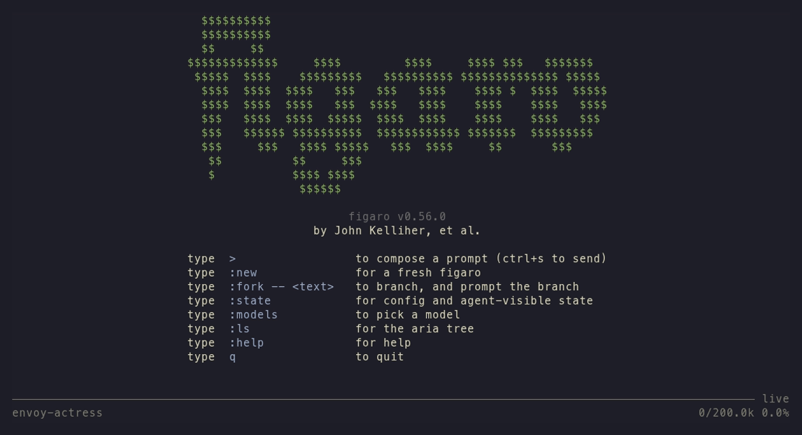
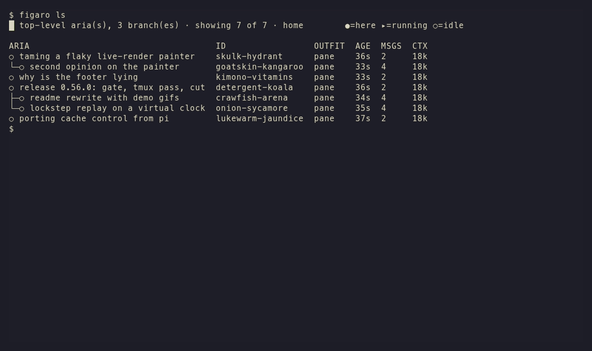

<p align="center">
  <a href="https://figar.org"></a>
</p>

<p align="center">
  <a href="https://github.com/jack-work/figaro/releases/latest"></a>
  <a href="./LICENSE"></a>
  
  
</p>

# figaro

*Largo al factotum della calcolatore.*

figaro is an AI coding agent you talk to from your terminal. Send it a message and keep using your shell; short replies print inline, long ones open in a pager. Conversations (we call them arias) live on disk, fork at any turn, and can message each other, so five agents at once is five shell commands. It's all one Go binary: the CLI and the daemon that runs the agents. Works with Claude (API key or Max subscription), GitHub Copilot, OpenRouter, Azure, and anything that speaks the OpenAI API.

A coding agent with few opinions, firmly held. Tutto pulito, bravo bravissimo.

<p align="center"></p>

> [!NOTE]
> figaro is under heavy development. Releases go out several times a day, most of them cut by figaros themselves (the agent builds, tests and releases itself, with a human signing off). Things move and sometimes break. Pin a version if you need it to sit still; see [Releases](#releases).

## Why figaro

Rather than running a binary and typing a message in a chatbox, figaro wants to be passed messages from the shell using CLI verbs. You send a message and get your shell back. When you want to look at what it's doing, `figaro listen` follows it live and `figaro show` prints recent turns.

Arias are append-only logs on disk. `figaro fork` branches one at any turn, and `figaro attend` points your shell at one, like `cd` for conversations.

Any aria can message any other with `figaro send`, and `-f` hands the message off without blocking. Fork one and hand it the work, or have one review another. This repo is mostly built that way.

Each aria has a form: key/value state the model sees as system reminders, which you can edit without a model round trip (`figaro set mantra "..."`).

Bare `figaro` opens the pager: vim keys, search, and the tree of all your arias.

Provider, model, credo and skills live in outfits, small TOML files that layer. Switch models between turns with `figaro set`.

## Install

One static binary, no runtime deps. Pick a line.

```bash
curl -fsSL https://figar.org/install.sh | sh
```

```powershell
irm https://figar.org/install.ps1 | iex
```

```bash
nix profile install github:jack-work/figaro
go install github.com/jack-work/figaro/cmd/figaro@latest
```

The shell installer takes `--version` and `--dir`, which under a pipe go after `--`: `curl -fsSL https://figar.org/install.sh | sh -s -- --dir /usr/local/bin`. It installs to `~/.local/bin` by default, checks the release sha256 and writes shell completions.

figaro is also reachable as `fig`. Every path above installs the alias except `go install`, which needs one line: `ln -s figaro $(go env GOPATH)/bin/fig`. Config lives in `~/.config/figaro/`.

## First run

```bash
figaro provider login anthropic   # or copilot, openrouter, azure
figaro                            # opens the pager on a fresh aria
```

<p align="center"></p>

Type `>` to write a prompt and `ctrl+s` to send it. Or skip the pager entirely:

```bash
figaro -- buongiorno
```

`figaro -- :skills.howto!` starts a tutorial, taught by figaro in character.

## Everyday use

```
figaro -- <prompt>              prompt the aria this shell is attending
figaro                          open the pager (at a terminal)
figaro new -- <prompt>          a fresh aria
figaro fork -- <prompt>         branch here and prompt the branch
figaro fork <id>:12 -- <p>      branch at turn 12
figaro send -f --id <id> -- <p> message another aria and get your shell back
figaro send -r -- <prompt>      raw streamed output, for scripts
figaro ls                       your arias, as a tree
figaro attend <id>              bind this shell to an aria
figaro listen <id>              watch an aria without prompting it
figaro show <id> -n 5           the last five turns
figaro set <key> <value>        patch the form, no model round trip
figaro status                   one aria in focus
figaro models                   every model your providers offer
figaro help <command>           the rest
```

Ids are long but you rarely type them. Every aria gets a word handle (`bunny-computer`), and any unique prefix works.

Idiomatically, a shell alias or binary `q` may be defined which aliases to `fig send --`. The single character makes the standard use case, messaging figaro and staying in your shell, easier to type. I use this alias and several others to avoid CLI verbiage. Figaro is in the service of the user; figaro-specific shell configurations are idiomatic.

### The pager

In the pager:

- `>` composes, `ctrl+s` sends, `esc` backs out
- `:new`, `:fork -- <text>`, `:attend <id>` move between arias
- `l` opens the topology at the aria you're on, `L` at the root, `:ls` the whole tree
- `:state` shows the form, `:models` picks a model
- `/` searches, `v` and `V` select, `y` yanks
- `q` leaves, and the turn keeps running

Keys are rebindable in `~/.config/figaro/keys.toml` (`figaro keys` lists them).

<p align="center"></p>

## Concepts

- aria: a conversation. An append-only log on disk, loaded by the daemon (the angelus) only when you touch it.
- fork: a branch at a turn. Both sides share the prefix on disk and in the provider's prompt cache.
- form: key/value state the model sees as reminders. An aria's own form is its board. A form that points at an aria is a role, so `figaro send @reviewer` reaches whoever holds it.
- mantra: the 5 to 10 words `figaro ls` prints next to each aria. The aria keeps it current.
- outfit: a TOML file with provider, model, credo and skills. New arias are made from one, and they layer.
- skill: a markdown file the model opens when it needs it. The `figaro` skill is built into the binary.
- tools: bash, read, write, edit, process, image, run in parallel.

The skill is the real manual: [`skills/figaro`](skills/figaro/SKILL.md), with the [CLI reference](skills/figaro/cli.md), [forms](skills/figaro/forms.md), [providers](skills/figaro/reference/providers.md) and [architecture](skills/figaro/reference/architecture.md).

## Providers

| Provider | Sign in | Notes |
|---|---|---|
| Anthropic | API key, or Claude Max via OAuth | Messages API, prompt caching on by default |
| GitHub Copilot | personal or enterprise | Claude models over Messages, GPT models over the Responses WebSocket |
| OpenRouter | API key | |
| Azure OpenAI / AI Foundry | API key or Microsoft Entra | |
| any OpenAI-compatible gateway | optional key | Chat Completions or Responses |

Each lives in `~/.config/figaro/providers/<name>.toml`; [providers.md](skills/figaro/reference/providers.md) has the details, and `figaro models` shows what's reachable right now. File an issue if you want to see another provider supported.

## Releases

Most releases are cut by an aria that ran the release script after the tests and a tmux pass on the real binary. Each one's notes are on its [GitHub release](https://github.com/jack-work/figaro/releases).

- To track the latest: `nix profile install 'github:jack-work/figaro?ref=release'`, or any of the installers above. `figaro update` tells you when you're behind, and how to upgrade for the way you installed.
- To pin: `github:jack-work/figaro/v0.56.0` in a flake, `go install ...@v0.56.0`, or `install.sh -s -- --version v0.56.0`.

Pre-1.0, minors may change the on-disk format or the client/daemon protocol. When they do, the notes say so and say whether anything migrates.

## In development

These are in the tree and I use them every day, but they will change:

- Troupes: several machines' figaros as one troupe, with signed membership, node certificates and arias that move between nodes. See `figaro troupe` and the [architecture notes](skills/figaro/reference/architecture.md#troupe-keys).
- Sandboxes: `figaro box` serves a sandbox over a unix socket so an aria gets only what you give it. Today figaro otherwise runs with your own user's permissions and can message any other aria on its node.
- Remote attend: opening an aria on another node in your pager, with your own login. Being built now.

## Contributing

Found something broken? File an issue. To hack on it:

```bash
nix develop                     # Go, tools, and an isolated vault and state dir
go build ./... && go test ./...
```

The dev shells keep a dev daemon away from your real store; [contributing](skills/figaro/contributing/README.md) has the rest, including how this repo's own agents work on it.

## License

[NON-AI MPL-2.0](./LICENSE). Copylot, source available for human use. Not for AI/ML training (LICENSE section 3.6).
