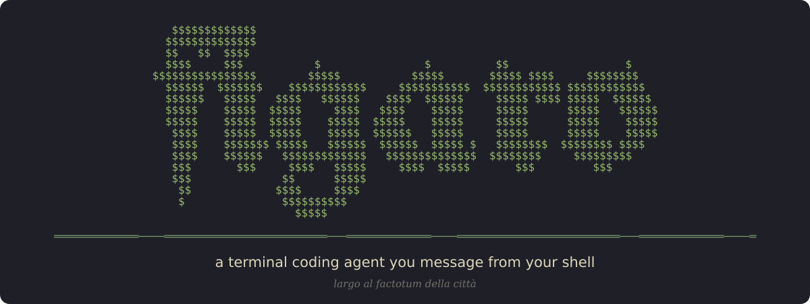
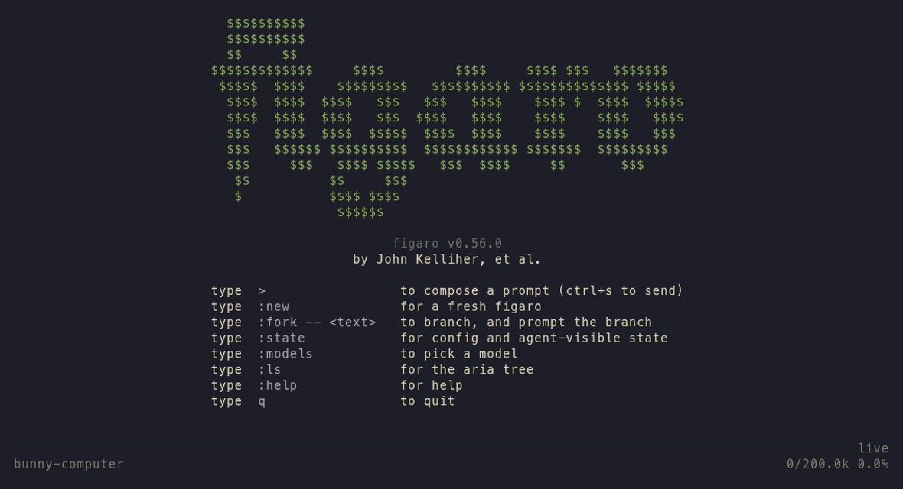
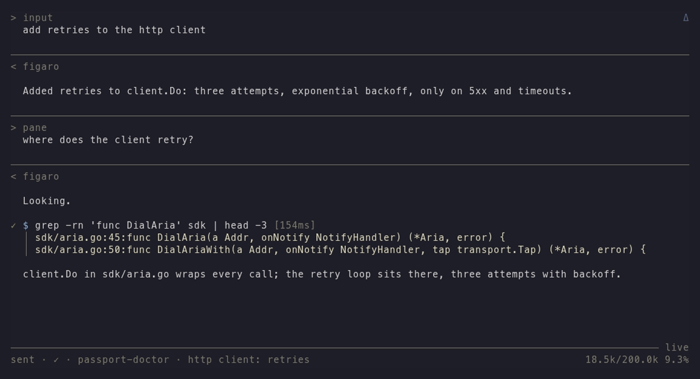

<p align="center">
  <a href="https://figar.org"></a>
</p>

<p align="center">
  <a href="https://github.com/jack-work/figaro/releases/latest"></a>
  <a href="./LICENSE"></a>
  
  
</p>

*Largo al factotum della calcolatore.*

figaro is a programmer's harness. Its agents, figaros, are durable: each one is a log on disk, served by a daemon that keeps well over a thousand of them in under 500 MB of memory and runs fast on a laptop from 2004. Works with Claude, GitHub Copilot, OpenRouter, Azure, and any provider that speaks Anthropic Messages, OpenAI Chat Completions or the Responses API.

<p align="center"></p>

> [!NOTE]
> figaro is under heavy development and released several times a day, mostly by figaros themselves. Pin a version if you need it to sit still ([Releases](#releases)).

## Agents you can see and steer

- Jump between figaros fast and attend any subagent: `figaro attend <id>`, `figaro listen <id>`, `figaro show <id>` with every tool call it made.
- `figaro fork <id>:12 -- <p>` branches at any turn, and `figaro promote <id>` raises a fork in the tree at once.
- Compaction is forking: `figaro succeed @role -- <handoff>` forks, hands off and recasts the role, so you can read exactly what was carried over.
- The daemon works like a tmux server. Drop the SSH connection and the turn keeps running, so a whole workflow built on figaro still works over SSH.

## The prompt cache stays warm

Providers keep a KV cache: the attention keys and values for a prompt prefix they have already processed, reused by any request that starts with the same bytes. Cache reads cost a fraction of fresh input ([Anthropic](https://docs.anthropic.com/en/docs/build-with-claude/prompt-caching): 0.1x, or 0.05x on Opus 5.5 and Sonnet 5.5; [OpenAI](https://platform.openai.com/docs/guides/prompt-caching): up to 95% off) and reach the first token sooner. figaro keeps each agent's prefix byte-stable: a message is translated once and resent byte for byte, state arrives as reminders on the newest message, and forks start from their parent's bytes. In my tests about 96% of input tokens are cache reads.

## Forms

A form is a durable object: key/value state with an append-only patch log, fsync'd before anyone can read it, and an immutable AVL tree in memory that readers never lock. A figaro that studies a form (`figaro study <id> @form`) gets each change as a delta on its next message, without starting a turn or rewriting what came before. Put web data in a form, add a heartbeat (we use figla) or a `figaro send`, and your agents react to your data as it changes:

```bash
figaro form new -S name=repo
figaro set --id @repo stats "$(curl -s https://api.github.com/repos/jack-work/figaro | jq -c '{stars: .stargazers_count}')"
```

[Methods](skills/figaro/reference/methods.md) are small, fast models that write form data on hooks; the first one picks the reasoning effort for each message. The Go SDK (`sdk/`) reads, patches and follows forms from your own code.

## Hierarchies, not factories

figaro doesn't hand each task to a fresh worker and throw it away. A fork inherits its parent's history up to the fork point and appends its own from there; history is never rewritten. Because forks share that history, they group naturally under the figaro they came from, and the tree can be rearranged later with `promote` and `succeed`. A figaro can fan out as the work demands, and a branch earns its permanence over time, at the pace of your work rather than a pipeline drawn in advance.

Three verbs grow a hierarchy: `fork` branches at any turn, `promote` raises a branch, and `succeed` hands a seat to a fork of whoever holds it. When a branch produces something worth keeping, cast it into a role (a named form that always reaches its current holder) and dress it with an outfit, which sets the credo, rules and model it runs under:

```bash
figaro new -- "Read internal/store and summarize how a fork is written."    # tubeless-obtain
figaro send -- "List the fsync calls on that path."
figaro fork tubeless-obtain:2 -- "Review that path for a missed fsync."    # dioxide-fiddle
figaro form new -S name=reviewer
figaro cast dioxide-fiddle @reviewer
figaro succeed @reviewer -O reviewer --turn head -- "You hold the review seat now."
figaro send -f @reviewer -- "Review the next change."
```

The comments are the handles figaro printed, and `reviewer` is `~/.config/figaro/outfits/reviewer.toml`, a `[system]` table holding one `credo`. The fork keeps turn 1 and asks a new turn 2. Instructions are written into a figaro's history early, and a change of instructions is appended so that it occludes the old ones rather than rewriting them; forks taken at earlier points keep their prompt caches. Here the outfit goes on with `succeed` (or `fork -O`): the successor is a fork of the reviewer that carries its whole history with the new credo on top, and the predecessor retires beneath it. `figaro ls` then shows:

```
├─○ reviewer @freeway-yiddish                             @freeway-yiddish  role → dynamite-boiler
└─○ form @kamikaze-feline                                 @kamikaze-feline  unbound
  └─○ Read internal/store and summarize how a fork..      tubeless-obtain   4 msgs
    └─▸ Read internal/store and summarize how a fork..    dynamite-boiler   10 msgs
      └─○ SUCCEEDED: Read inte.. [retired, reaps in 10m]  dioxide-fiddle    6 msgs
```

Anything that sends to `@reviewer` reaches `dynamite-boiler` now, and its successor later.

In practice a hierarchy doubles as an agent management structure: roles, outfits and inheritance let you define complex relationships across a large cast of figaros.

## Scale and durability

- About 1,700 figaros on my machine, and the daemon sits around 320 MB under a 512 MB soft limit (`[memory] soft_limit_mb`).
- Crash-safe: every log is append-only and synced before it's visible, and a prompt sent during a restart is spooled and delivered after.
- `/` in `:ls` fuzzy-finds a figaro by handle or mantra, `:comment` pins a note to a passage, and `M-Enter` opens `file:line` in your editor.
- I daily-drive it at my big tech employer: hundreds of hours of heavy use, and it cooks.

## Federation and deployment

- Listen to a figaro on any server with `FIGARO_TROUPE=<name> figaro listen <id>`. Machines federate as troupes, still in development.
- Identity and authorization plug in across machines too; see [Security](#security-bring-your-own-sandbox).
- A Nix flake with NixOS, home-manager and container modules. Sandboxing with `figaro box` and the container module.

## The shell or the pager

Drive figaros from the shell (`figaro -- <prompt>`, `figaro send -f`) or from the pager (bare `figaro`). Neither is required; the shell is the quick one.

<p align="center"></p>

## Security: bring your own sandbox

figaro is built to run inside the sandbox and identity system you already have, and every piece of that is pluggable.

- Sandboxes: A figaro's tools run wherever you put them: `figaro box serve` gives a workspace its own door, and the NixOS container module runs the whole daemon isolated. Boxed figaros only reach what their box allows.
- Identity: Every caller is a principal: your local user by peer credentials, or a remote one through OIDC issuers you trust (`[[authz.issuers]]`), your reverse proxy's user headers (`authn = "upstream"`), or troupe API keys. Nodes in a troupe prove themselves with certificates from your own troupe root.
- Authorization: Grants give each principal verbs (read, send, set, kill, admin) on the figaros and forms it may touch; troupe policy does the same across machines; lifetime and environment keys stay owner-held.
- No MCP, by design: figaro is CLI-first: wrap an MCP server in a CLI and put it in a box.

Out of the box, with no sandbox configured, a figaro has your user's permissions. A figaro's `system.scopes` narrows what it may do (`figaro scopes <id>`), but it binds only calls that name the figaro, and a tool running as you can leave the name off. Secure defaults ship in coming releases.

## Install

```bash
curl -fsSL https://figar.org/install.sh | sh
irm https://figar.org/install.ps1 | iex          # Windows
nix profile install github:jack-work/figaro
go install github.com/jack-work/figaro/cmd/figaro@latest
```

## First run

```bash
figaro provider login anthropic   # or copilot, openrouter, azure
figaro -- buongiorno              # or bare figaro, for the pager
```

`figaro -- :skills.howto!` starts a tutorial. The manual is the [figaro skill](skills/figaro/SKILL.md), which ships inside the binary.

## Providers

| Provider | Sign in | Notes |
|---|---|---|
| Anthropic | API key, or Claude Max via OAuth | Messages API, prompt caching on by default |
| GitHub Copilot | personal or enterprise | Claude models over Messages, GPT models over the Responses WebSocket |
| OpenRouter | API key | |
| Azure OpenAI / AI Foundry | API key or Microsoft Entra | |
| any other provider | optional key | point a provider file's `base_url` at it; Messages, Chat Completions or Responses (HTTP or WebSocket) |

Each lives in `~/.config/figaro/providers/<name>.toml`. A local model server or your company's gateway is one file with a `base_url`; [providers.md](skills/figaro/reference/providers.md) has the details, and `figaro models` shows what's reachable right now. File an issue if you want to see another provider supported.

## Releases

Most releases are cut by a figaro after the tests and a tmux pass on the real binary; notes are on [GitHub](https://github.com/jack-work/figaro/releases). Track `github:jack-work/figaro?ref=release` (`figaro update` tells you when you're behind) or pin a tag like `github:jack-work/figaro/v0.56.2`. Hacking on it: [contributing](skills/figaro/contributing/README.md).

## License

[NON-AI MPL-2.0](./LICENSE). Copylot, source available for human use. Not for AI/ML training (LICENSE section 3.6).
